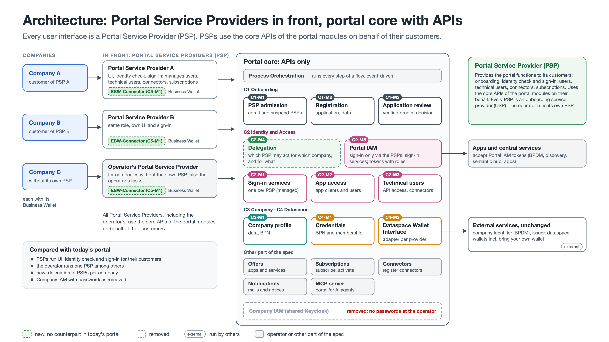

# Portal Backend Spec

Module specifications for a modernized Eclipse Tractus-X portal backend, prepared for the hackathon.

> **Status:** work in progress. Feedback and proposals are welcome via issues and pull requests.

## Architecture: Portal Service Providers in front, portal core with APIs

### Why

Today's portal is a monolith: the user interface owns orchestration and business rules, and a third party cannot use a capability without the portal UI. In practice, participants use it mostly once, during onboarding. The new architecture splits the portal into modules with clear interfaces and makes these interfaces the only way in.

### Portal core and Portal Service Providers

- **The portal core offers APIs only.** It has no user interface of its own.
- **Every user interface is a Portal Service Provider (PSP).** A PSP provides the portal functions to its customers: onboarding, identity check and sign-in, users, technical users, connectors and subscriptions. It uses the core APIs of the portal modules on their behalf.
- **Every PSP is an onboarding service provider (OSP).** The PSP extends today's OSP beyond onboarding.
- **The operator runs its own PSP** for companies without one. The operator's tasks, such as reviewing applications, are rights of this PSP. The operator's PSP is built at the hackathon.

### How the core controls access

- **Admission:** the operator admits a new PSP after a review (C1-M1). On approval, the PSP gets its API access as a technical user (C2-M3) and its sign-in service in the Portal IAM (C2-M1). The operator can suspend a PSP.
- **Delegation:** the core records which PSP may act for which company, and for what (C2-M4). A call on behalf of a company carries a token of the PSP; the module checks the rights in the token and the delegation.
- **Sign-in:** people sign in at their PSP. Where the Portal IAM is needed, for example to open an app, it forwards to the sign-in service of the PSP. There are no passwords at the operator; today's Company IAM with one realm per company is removed.
- **Portal IAM (C2-M5):** the central IAM is configured only (Keycloak, no extensions). It holds the rights of the PSPs at the core APIs, the sign-in to apps with app roles (app users, C2-M2), and tokens for central services (technical users, C2-M3).
- **Business Wallet:** the EBW-Connector (C5-M1) verifies proofs from the European Business Wallet. PSPs use it for onboarding and sign-in.

### Flows and data

- Every step of a flow, such as onboarding, runs through Process Orchestration and is event-driven. Modules call each other directly only for queries.
- Each module has its own database. No module reads or writes the database of another module; it uses that module's interface. Events go out through an outbox per module and never carry secrets.

## Modules

| Module | Status |
|---|---|
| [C1-M1 PSP Admission](C1-M1-PSPAdmission/) | to be specified |
| [C1-M2 Registration](C1-M2-Registration/) | to be specified |
| [C1-M3 Application Review](C1-M3-ApplicationReview/) | to be specified |
| [C2-M1 Sign-in Services](C2-M1-SignInService/) | to be specified |
| [C2-M2 App Access](C2-M2-AppAccess/) | draft 0.1 (app clients and roles; app users to be added) |
| [C2-M3 Technical Users](C2-M3-TechnicalUser/) | draft 0.1 (to be updated for PSPs) |
| [C2-M4 Delegation](C2-M4-Delegation/) | to be specified |
| [C2-M5 Portal IAM](C2-M5-PortalIAM/) | configuration, to be specified |
| [C3-M1 Company Profile](C3-M1-CompanyProfile/) | to be specified |
| [C4-M1 Credentials](C4-M1-Credentials/) | to be specified |
| [C4-M2 Dataspace Wallet Interface](C4-M2-DataspaceWalletInterface/) | to be specified |
| [C5-M1 EBW-Connector](C5-M1-EBWConnector/) | to be specified |

Modules from the other part of the spec (Process Orchestration, Offers, Subscriptions, Connectors, Notifications, MCP server) are referred to by name.

The module numbers changed with the Portal Service Provider architecture. The former C2-M6 App Clients and Roles is now part of C2-M2 App Access.

## Format

Each module has its own folder, named after its identifier, with two files:

- `README.md` – the behaviour: purpose, data, rules, every operation step by step, calls to other modules, errors, acceptance criteria and test data
- `openapi.yaml` – the interface (OpenAPI 3.1)

A team should be able to implement a module from these two files alone.

Modules are grouped into capabilities: `C2-M3` is module 3 of capability C2.

## License

Licensed under the [Apache License 2.0](LICENSE).
