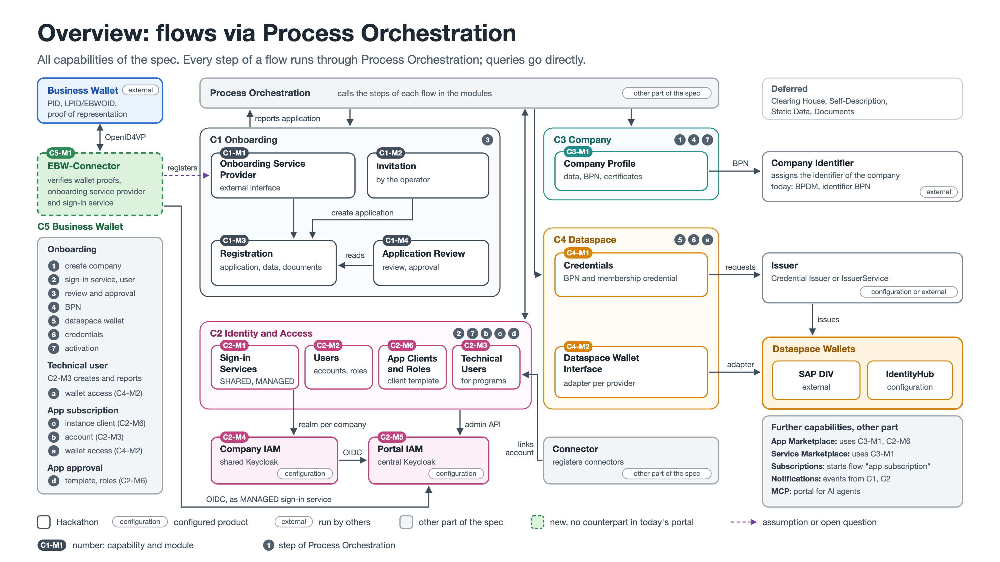

# Portal Backend Spec

Module specifications for a modernized Eclipse Tractus-X portal backend, prepared for the hackathon.

> **Status:** proposal. The format and the cut into modules are open for discussion via issues and pull requests.

## Format

Each module has its own folder, named after its identifier, with two files:

- `README.md` – the behaviour: purpose, data, rules, every operation step by step, calls to other modules, errors, acceptance criteria and test data
- `openapi.yaml` – the interface (OpenAPI 3.1)

A team should be able to implement a module from these two files alone.

Modules are grouped into capabilities: `C2-M3` is module 3 of capability C2. Modules from parts of the spec that are not numbered yet are referred to by name.

## Overview

Every step of a flow, such as onboarding, runs through Process Orchestration. Modules call each other directly only for queries.

## Modules

| Module | Status |
|---|---|
| [C2-M3 Technical Users](C2-M3-TechnicalUser/) | draft 0.1 |
| [C2-M6 App Clients and Roles](C2-M6-AppClientsAndRoles/) | draft 0.1 |
